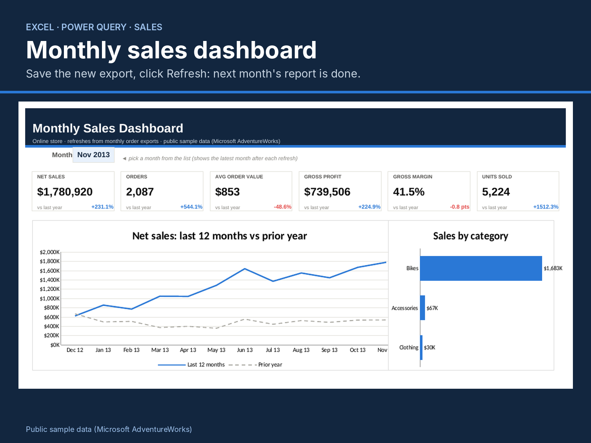
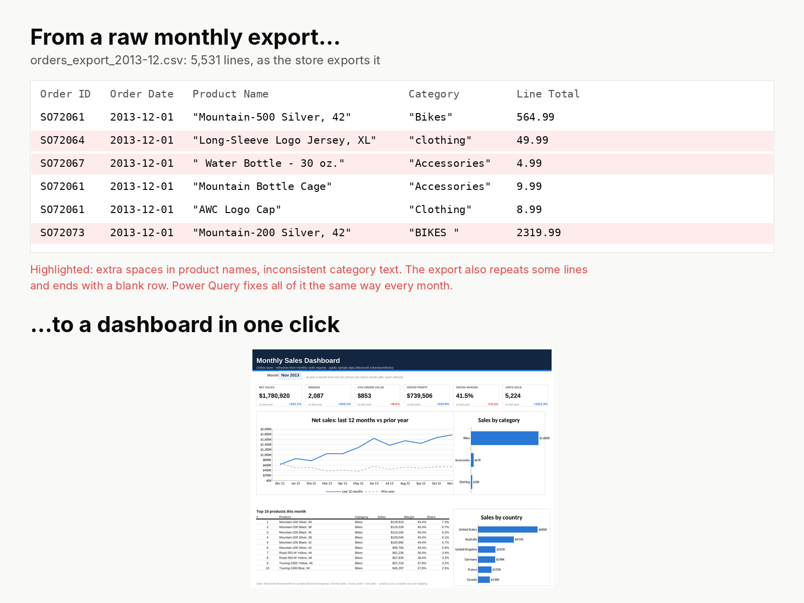

# Monthly Sales Dashboard in Excel (Power Query refresh)

**Save the new month's export, click Refresh: the report is done.** A one-page Excel sales dashboard for an online store that rebuilds itself from raw order exports, cleaning the data the same way every month.

> Public sample data: Microsoft **AdventureWorksDW** internet sales (a fictional bicycle company), exported as 25 monthly Shopify-style CSV files (Dec 2011 – Dec 2013). Small data-quality issues were added on purpose so the cleaning has real work to do.



## What it does
| | |
|---|---|
| **Input** | One CSV per month in `exports/`, as a store exports it |
| **Cleaning (Power Query)** | Stacks all files; removes blank rows and 169 duplicate lines; fixes 1,128 product names with extra spaces and 846 inconsistent category values; adds Month and Line Cost |
| **Dashboard** | Month selector; 6 KPIs vs same month last year (net sales, orders, average order value, gross profit, gross margin, units); 12-month trend vs prior year; sales by category and country; top 10 products with margin and share |
| **Monthly effort** | Save the file, Data → Refresh All |



## Files
```
Sales_Dashboard.xlsx        Dashboard, Calc (formulas), Data (query output), How to refresh
exports/                    25 monthly order exports (CSV)
power_query/SalesExports.m  the refresh query, commented step by step
docs/Dashboard_User_Guide.pdf  one-page guide for the store owner
gallery/                    images
```

## Set up the refresh (once, about 5 minutes)
1. Copy this folder to `C:\SalesDashboard\` (or anywhere; you will paste the path in step 4).
2. Open `Sales_Dashboard.xlsx`. On the **Data** sheet press Ctrl+A, then Delete, to clear the sample values.
3. **Data → Get Data → From Other Sources → Blank Query.**
4. **Home → Advanced Editor**, paste `power_query/SalesExports.m`, and change `FolderPath` to your `exports` folder (keep the final backslash). Click **Done**.
5. In **Query Settings**, name the query `SalesExports`.
6. **Home → Close & Load To… → Table → Existing worksheet → `=Data!$A$1` → OK.**

The dashboard reads columns A–Q of the Data sheet by position, so the query's column order must stay as written.

## Checks
| State | Rows on Data | Month shown | Net sales | Orders | Gross margin |
|---|---|---|---|---|---|
| Shipped workbook (Dec 2011 – Nov 2013) | 50,900 | Nov 2013 | $1,780,920 | 2,087 | 41.5% |
| After refresh with all 25 files | 56,420 | Dec 2013 | $1,874,360 | 2,192 | 41.4% |

## How it is built
- **Power Query** does all cleaning, with culture-fixed types (`en-US`) so it behaves the same on any PC.
- **Formulas** use `SUMIFS`/`COUNTIFS` on named columns (`D_Sales`, `D_Month`…), so the dashboard keeps working whatever the number of rows.
- **Orders** count line item 1 of each order, so each order counts once without a distinct-count formula.
- **Top 10** uses `LARGE` with a tiny row-based tie-break, so two products with equal sales still get different ranks.
- Works in Excel 2016 or later and Microsoft 365. No macros, no add-ins.

*Saad Attia · Sales & Profitability Analyst*
